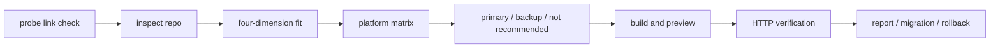

<h1 align="center">deploy-advisor</h1>

<p align="center">
  <b>English</b> | <a href="./README.md">简体中文</a>
</p>

Choose the right platform first, then deploy and verify. A multi-platform skill for developers and AI agents.



Shortest path (run in your project directory; `SKILL_DIR` points to this skill):

```sh
node "$SKILL_DIR/scripts/select-platform.mjs" --project . --audience mainland --budget free --usage personal_noncommercial --existing none --human
```

## Contents

- [Why this project](#why-this-project)
- [Quick Start](#quick-start)
- [Usage](#usage)
- [Configuration](#configuration)
- [Project Structure](#project-structure)
- [Development](#development)
- [FAQ](#faq)
- [Known Limitations](#known-limitations)
- [Contributing](#contributing)
- [License](#license)

## Why this project

The cost of choosing the wrong platform usually appears after launch: unstable access, a commercial-use restriction, or a migration without a rollback path. This skill changes the order: judge platform fit first, then deploy, then verify with real HTTP requests.

It is for developers deploying projects and for people who install or author Agent Skills. Instead of naming one platform, it returns a primary, a backup, and a not-recommended set, and keeps Pages vs Workers, Hobby vs Pro, commercial use, and mainland access risk separate.

It does not claim to finish the final deployment. DNS, custom domains, production secrets, plan upgrades, and database migrations require your confirmation.

## Quick Start

Requirements: Node.js 18+ (22+ recommended for actual deployments), Git, and optionally an Agent client that supports Skills.

Place this folder in your Agent skills directory. The examples use `~/.agents/skills`; replace it with the path your client documents:

```powershell
# Windows: junction, no admin required
New-Item -ItemType Junction `
  -Path "$env:USERPROFILE\.agents\skills\deploy-advisor" `
  -Target "C:\path\to\deploy-advisor"
```

```bash
# macOS / Linux
ln -s /path/to/deploy-advisor ~/.agents/skills/deploy-advisor
```

If links are unavailable, copy the folder. There is no `npm install` and no build step.

Set the skill directory variable. Run the commands below inside your project directory, not inside this skill directory (`detect` will not recognise the skill itself):

```sh
# macOS / Linux
export SKILL_DIR=/path/to/deploy-advisor
```

```powershell
# Windows PowerShell
$SKILL_DIR = "C:\path\to\deploy-advisor"
```

First run:

```sh
node "$SKILL_DIR/scripts/probe.mjs" --repo "$PWD"
node "$SKILL_DIR/scripts/detect-project.mjs" . --human
node "$SKILL_DIR/scripts/select-platform.mjs" --project . --audience mainland --budget free --usage personal_noncommercial --existing none --human
```

`probe` uses exit codes for the link verdict: `0` ready, `1` limited, `2` blocked. `detect` prints the framework, build command, output directory, render mode, and confidence. `select` prints candidates, primary / backup / not-recommended, and the mainland access-risk notice.

Uninstall: remove the junction or symlink. Do not delete the source directory.

## Usage

Common scenarios:

| Scenario | Command |
|---|---|
| Static / SPA / SSG | `node "$SKILL_DIR/scripts/select-platform.mjs" --render static --audience overseas --budget free --usage personal_noncommercial --existing none --human` |
| SSR / full-stack / API | `node "$SKILL_DIR/scripts/select-platform.mjs" --render ssr --backend serverless --audience mainland --budget free --usage personal_noncommercial --existing none --human` |
| Healthy existing Pages | `node "$SKILL_DIR/scripts/select-platform.mjs" --render ssr --existing cloudflare-pages --existing-status healthy --audience overseas --budget free --usage personal_noncommercial --human` |
| Migration plan | `node "$SKILL_DIR/scripts/migration-plan.mjs" --source github-pages --target cloudflare-pages --project-type ssg --human` |
| Build artifact check | `node "$SKILL_DIR/scripts/check-build.mjs" --dir dist --mode static` |
| HTTP verification | `node "$SKILL_DIR/scripts/verify-deployment.mjs" --url https://example.com --mode static --json` |

Real output example:

```text
$ node "$SKILL_DIR/scripts/select-platform.mjs" --render ssr --backend serverless --audience overseas --budget free --usage personal_noncommercial --existing none --json | node -e "let s='';process.stdin.on('data',d=>s+=d).on('end',()=>{const j=JSON.parse(s);console.log(j.selection.primary.id)})"
vercel-hobby
```

The human-readable CLI labels are Chinese in this version; JSON keys and the `--json` output stay English so scripts can read them.

Main scripts and exit codes:

| Script | Purpose | Key flags | Exit codes |
|---|---|---|---|
| `probe.mjs` | Check account, network, permissions, and code-host reachability | `--repo` | 0 ready / 1 limited / 2 blocked |
| `detect-project.mjs` | Detect framework, build command, output directory, and render mode | directory, `--human`, `--json` | see `--help` |
| `select-platform.mjs` | Four-dimension fit assessment and platform shortlist | `--render`, `--backend`, `--audience`, `--budget`, `--usage`, `--existing`, `--human` | 0 result / 1 insufficient input / 2 usage error |
| `migration-plan.mjs` | Generate pre-check, dual-live steps, DNS gate, and rollback | `--source`, `--target`, `--project-type`, `--human` | 0 plan / 1 blocked / 2 usage error |
| `check-build.mjs` | Check file count, asset references, and build output | `--dir`, `--mode`, `--plan`, `--target` | 0 no blocker / 1 blocker |
| `verify-deployment.mjs` | Verify root, routes, assets, and APIs with real HTTP requests | `--url`, `--mode`, `--api`, `--json` | 0 pass / 1 failure / 2 usage error |

The final Cloudflare deployment is not automatic. After `probe`, `check-env`, `check-build`, and preview verification, run:

```sh
npx wrangler pages deploy "<output-dir>" --project-name "<project-name>"
npx wrangler deploy
```

Pages and Workers are separate products; do not reuse the same configuration assumptions. Other platforms are executed manually via their official Git integration or CLI.

## Configuration

Platform selection needs no secrets. Only CI or non-interactive Cloudflare operations need account variables:

| Variable | Required | Default | Description |
|---|---|---|---|
| `CLOUDFLARE_API_TOKEN` | No | — | CI or non-interactive deployment auth |
| `CLOUDFLARE_ACCOUNT_ID` | No | — | Cloudflare Account ID |
| `HTTPS_PROXY` / `NO_PROXY` | No | — | Proxy settings for the link probe |
| `PAGES_WRANGLER_MAJOR_VERSION` | No | — | Evidence for enabling the Wrangler v4 file limit on Pages |
| `NODE_EXTRA_CA_CERTS` | No | — | Tests only: trust the loopback TLS certificate |
| `CHROME_PATH` / `EDGE_PATH` | No | — | Optional browser differential tests |

Never write real tokens, passwords, or secret values into the repository, README, or migration plan. Migration plans record environment-variable key names only.

## Project Structure

```text
deploy-advisor/
├── SKILL.md          # agent workflow, routing, and safety gates
├── scripts/          # 14 dependency-free Node ESM scripts
├── references/       # platform matrix, migration, mainland access, domain, pricing, runtime
├── templates/        # deployment / migration plan and report templates
├── tests/            # 829 automated tests, structure check, loopback TLS fixture
├── deployment-notes/ # real project deployment records
└── facts.md          # README fact ledger
```

To add a platform, edit `references/platform-matrix.json`, declare `selection_pools` and commercial use, and add tests. Filtering reads the matrix, so there is no second hardcoded platform list.

`render_support` only describes high-level platform capability, not framework, runtime, database, or dependency compatibility.

## Development

```sh
node tests/run-tests.mjs     # 829/829 passing
node tests/check-skill.mjs   # structure check
node tests/browser-diff.mjs  # optional: real Chrome / Edge differential
```

Verify the platform counts:

```sh
node -e "const m=require('./references/platform-matrix.json'); console.log(m.platforms.length, m.platforms.filter(p=>p.core).length)"
# 10 5
```

There is no `package.json`, `npm install`, bundling, or lint step; the scripts run directly. Before committing, run `run-tests` and `check-skill`, and update both README files.

## FAQ

**Q: Does it deploy to production automatically?**  
A: No. It does not complete the final deployment, DNS, domain, plan, or database operations. Cloudflare previews can be deployed by command; production requires your confirmation.

**Q: Does it support SSR / full-stack?**  
A: It supports detection, selection, migration planning, and partial HTTP verification. `check-build.mjs` reports skip for SSR; runtime compatibility, login, databases, and third-party callbacks still need dedicated checks.

**Q: Pages or Workers?**  
A: Static sites default to Pages; new SSR / full-stack / API projects prefer Workers; a healthy existing Pages deployment is kept, not forced to migrate. Pages Functions are not Workers.

**Q: Can it guarantee stable access from mainland China?**  
A: No. Default-domain behavior is a network observation or unverified, not an official platform guarantee. Stable mainland access needs an ICP filing plus a domestic cloud or CDN.

**Q: Does it read or write secret values?**  
A: No. It does not read, print, or write secret values. Migration plans record key names only; you configure the values in the platform environment variables.

**Q: Why does `detect` return `unknown`?**  
A: Check that you are in the project you want to deploy, not this skill directory. `detect` reads the framework and build config of the current directory; the skill itself is not a deployable project.

**Q: Why is there no screenshot on the first screen?**  
A: This is a CLI and documentation skill. The first screen uses Mermaid and a real terminal example. Real project screenshots live in `deployment-notes/` and do not prove every platform.

## Known Limitations

- No real Vercel, Netlify, Render, GitHub Pages deployment or migration was performed; automated tests use local fixtures and loopback HTTP servers.
- No mainland-China measurements. Vercel, GitHub Pages, Netlify, and Cloudflare default-domain behavior is labelled as observation or unverified.
- It does not buy domains, switch DNS, upgrade plans, or migrate databases.
- SSR / full-stack script coverage stops at the HTTP layer; `render_support` is not a framework-compatibility guarantee.
- The HTML tokenizer covers common boundaries but is not a full HTML5 tree builder; use a browser for DOM-level conclusions. See `tests/results.md`.

## Contributing

Issues and pull requests are welcome. Ask questions in [Issues](https://github.com/ChenChen913/deploy-advisor/issues). There is no separate `CONTRIBUTING.md` yet.

Before submitting, run `node tests/run-tests.mjs` and `node tests/check-skill.mjs`, and keep commands, numbers, and limitations in sync across `facts.md`, `README.md`, and `README.en.md`.

## License

This project is licensed under the [MIT License](./LICENSE). Copyright (c) 2026 ChenChen913.
