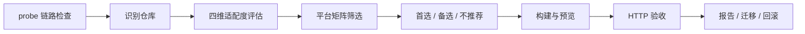

<h1 align="center">deploy-advisor</h1>

<p align="center">
  <b>简体中文</b> | <a href="./README.en.md">English</a>
</p>

先判断平台，再部署和验收。面向开发者和 AI Agent 的多平台部署选型、迁移与 HTTP 验收技能。



最短路径（在你要部署的项目目录运行，`SKILL_DIR` 指向本技能目录）：

```sh
node "$SKILL_DIR/scripts/select-platform.mjs" --project . --audience mainland --budget free --usage personal_noncommercial --existing none --human
```

## 目录

- [为什么做这个项目](#为什么做这个项目)
- [快速开始](#快速开始)
- [用法](#用法)
- [配置](#配置)
- [项目结构](#项目结构)
- [开发](#开发)
- [常见问题](#常见问题)
- [已知限制](#已知限制)
- [如何贡献](#如何贡献)
- [许可证](#许可证)

## 为什么做这个项目

选错平台的成本通常不在部署当天，而在上线后才发现访问不稳定、商业条款不适用，或者迁移时没有回滚路径。这个技能把顺序改过来：先判断项目适合哪个平台，再部署，最后用真实 HTTP 请求验收。

它面向需要部署项目的开发者，也面向安装和使用 Agent Skill 的作者。和只给一个平台名称的做法不同，它会同时给出首选、备选和不推荐，并把 Pages / Workers、Hobby / Pro、商业用途和大陆访问风险分开判断。

它不承诺自动完成最终部署。DNS、自定义域名、生产密钥、套餐升级和数据库迁移都需要你确认。

## 快速开始

前置要求：Node.js 18+（实际部署建议 22+）、Git；如果用 Agent 客户端，需要该客户端支持 Skill。

把本目录放到你的 Agent 技能目录。下面以 `~/.agents/skills` 为例，其他客户端按各自文档替换：

```powershell
# Windows：目录联接，不需要管理员
New-Item -ItemType Junction `
  -Path "$env:USERPROFILE\.agents\skills\deploy-advisor" `
  -Target "C:\path\to\deploy-advisor"
```

```bash
# macOS / Linux
ln -s /path/to/deploy-advisor ~/.agents/skills/deploy-advisor
```

没有链接权限时直接复制目录。没有 `npm install`，也没有构建步骤。

设置技能目录变量。下面的命令都在你要部署的项目目录里运行，不要在本技能目录里运行 `detect`：

```sh
# macOS / Linux
export SKILL_DIR=/path/to/deploy-advisor
```

```powershell
# Windows PowerShell
$SKILL_DIR = "C:\path\to\deploy-advisor"
```

第一次运行：

```sh
node "$SKILL_DIR/scripts/probe.mjs" --repo "$PWD"
node "$SKILL_DIR/scripts/detect-project.mjs" . --human
node "$SKILL_DIR/scripts/select-platform.mjs" --project . --audience mainland --budget free --usage personal_noncommercial --existing none --human
```

`probe` 用退出码表达链路结论：`0` ready、`1` limited、`2` blocked。`detect` 输出框架、构建命令、输出目录、渲染模式和证据等级。`select` 输出候选、首选 / 备选 / 不推荐，以及大陆访问风险。

卸载：删除上面的 junction 或 symlink 即可，不要删除源目录。

## 用法

常见场景：

| 场景 | 命令 |
|---|---|
| 纯静态 / SPA / SSG | `node "$SKILL_DIR/scripts/select-platform.mjs" --render static --audience overseas --budget free --usage personal_noncommercial --existing none --human` |
| SSR / 全栈 / API | `node "$SKILL_DIR/scripts/select-platform.mjs" --render ssr --backend serverless --audience mainland --budget free --usage personal_noncommercial --existing none --human` |
| 已有 Pages 且健康 | `node "$SKILL_DIR/scripts/select-platform.mjs" --render ssr --existing cloudflare-pages --existing-status healthy --audience overseas --budget free --usage personal_noncommercial --human` |
| 生成迁移计划 | `node "$SKILL_DIR/scripts/migration-plan.mjs" --source github-pages --target cloudflare-pages --project-type ssg --human` |
| 检查构建产物 | `node "$SKILL_DIR/scripts/check-build.mjs" --dir dist --mode static` |
| 部署后 HTTP 验收 | `node "$SKILL_DIR/scripts/verify-deployment.mjs" --url https://example.com --mode static --json` |

真实输出示例：

```text
$ node "$SKILL_DIR/scripts/select-platform.mjs" --render ssr --backend serverless --audience overseas --budget free --usage personal_noncommercial --existing none --human
【项目部署适配度】
- 渲染模式：SSR（confirmed）
- 后端需求：Serverless / 轻后端（confirmed）
- 目标用户：主要海外（confirmed）
- 预算：免费优先（confirmed）
- 使用性质：个人非商业（confirmed）
- 现有部署：无（不适用）
- 候选平台：Cloudflare Workers / Vercel Hobby / Render Free
- 排除平台：GitHub Pages（只能托管静态文件，不能运行 SSR / 全栈服务端代码）；Netlify Free（纯静态托管不适用；如使用 Netlify Functions / Edge 承载 SSR，需另行评估，不作为默认候选）；Cloudflare Pages（新 SSR / API 项目优先 Cloudflare Workers；Pages Functions 仅在已有 Pages 或明确选择时保留）；等 6 个
- 推荐首选：Vercel Hobby（个人非商业可用；Next.js / SSR 适配成熟）
- 免费额度：100 GB 传输/月；200 个项目；6,000 构建分钟/月；100 部署/天；仅个人非商业
- 主要限制：Hobby 仅个人非商业；默认域名大陆访问风险高（网络观测）；不适合长期运行服务
- 备选：Cloudflare Workers（SSR 需适配器；免费请求额度足够时可用）；Render Free（可接受冷启动；大陆访问未实测）
- 不推荐：GitHub Pages（只能托管静态文件，不能运行 SSR / 全栈服务端代码）；Netlify Free（纯静态托管不适用；如使用 Netlify Functions / Edge 承载 SSR，需另行评估，不作为默认候选）

【下一步】
- 先部署到预览地址，再用 verify-deployment.mjs 做 HTTP 验收；SSR / 数据库 / 登录 / 第三方回调仍需专项验证，没测就写“未验证”。
```

主要脚本和退出码：

| 脚本 | 作用 | 关键参数 | 退出码 |
|---|---|---|---|
| `probe.mjs` | 检查账号、网络、权限和代码托管链路 | `--repo` | 0 ready / 1 limited / 2 blocked |
| `detect-project.mjs` | 识别框架、构建命令、输出目录和渲染模式 | 目录、`--human`、`--json` | 见 `--help` |
| `select-platform.mjs` | 四维适配度评估和平台初选 | `--render`、`--backend`、`--audience`、`--budget`、`--usage`、`--existing`、`--human` | 0 有结论 / 1 信息不足 / 2 用法错误 |
| `migration-plan.mjs` | 生成迁移前检查、双活步骤、DNS 门和回滚 | `--source`、`--target`、`--project-type`、`--human` | 0 已生成 / 1 blocked / 2 用法错误 |
| `check-build.mjs` | 检查文件数、资源引用和构建产物 | `--dir`、`--mode`、`--plan`、`--target` | 0 无阻断 / 1 有阻断 |
| `verify-deployment.mjs` | 用真实 HTTP 请求验收首页、路由、资源和 API | `--url`、`--mode`、`--api`、`--json` | 0 通过 / 1 有失败 / 2 用法错误 |

Cloudflare 的最终部署不自动执行。确认 `probe`、`check-env`、`check-build` 和预览验收后，再运行：

```sh
npx wrangler pages deploy "<输出目录>" --project-name "<项目名>"
npx wrangler deploy
```

Pages 和 Workers 是两个独立产品，不要共用同一套配置假设。其他平台按官方 Git 集成或 CLI 人工执行。

## 配置

平台选择本身不需要密钥。只有 CI 或非交互式 Cloudflare 操作才需要账号变量：

| 变量 | 必填 | 默认值 | 说明 |
|---|---|---|---|
| `CLOUDFLARE_API_TOKEN` | 否 | — | CI 或非交互式部署认证 |
| `CLOUDFLARE_ACCOUNT_ID` | 否 | — | Cloudflare Account ID |
| `HTTPS_PROXY` / `NO_PROXY` | 否 | — | 链路探针的代理设置 |
| `PAGES_WRANGLER_MAJOR_VERSION` | 否 | — | Pages 项目启用 Wrangler v4 文件数上限的证据 |
| `NODE_EXTRA_CA_CERTS` | 否 | — | 仅测试：信任回环 TLS 自签证书 |
| `CHROME_PATH` / `EDGE_PATH` | 否 | — | 仅可选浏览器差分测试 |

不要把真实 Token、密码或密钥值写进仓库、README 或迁移计划。迁移计划只记录环境变量键名。

## 项目结构

```text
deploy-advisor/
├── SKILL.md          # Agent 主流程、路由和安全边界
├── scripts/          # 14 个零依赖 Node ESM 脚本
├── references/       # 平台矩阵、迁移、大陆访问、域名、付费、运行时资料
├── templates/        # 部署 / 迁移计划与报告模板
├── tests/            # 829 项自动化测试、结构检查、回环 TLS 夹具
├── deployment-notes/ # 真实项目部署记录
└── facts.md          # README 事实台账
```

新增平台时，编辑 `references/platform-matrix.json`，声明 `selection_pools` 和商业用途，再补测试。筛选逻辑会读取矩阵，不需要在多处硬编码平台列表。

`render_support` 只表示平台大类能力，不代表所有框架、运行时、数据库和依赖都兼容。

## 开发

```sh
node tests/run-tests.mjs     # 829/829 通过
node tests/check-skill.mjs   # 结构检查
node tests/browser-diff.mjs  # 可选：真实 Chrome / Edge 差分
```

平台数量和核心平台数量可以复核：

```sh
node -e "const m=require('./references/platform-matrix.json'); console.log(m.platforms.length, m.platforms.filter(p=>p.core).length)"
# 10 5
```

没有 `package.json`、`npm install`、打包或 lint 步骤；脚本直接运行。提交前至少跑 `run-tests` 和 `check-skill`，并同步修改两份 README。

## 常见问题

**Q：会自动部署到生产吗？**  
A：不会自动完成最终部署、DNS、域名、套餐或数据库操作。Cloudflare 预览可以按命令执行，生产上线需要你确认。

**Q：支持 SSR / 全栈吗？**  
A：支持识别、选型、迁移计划和部分 HTTP 验收。`check-build.mjs` 对 SSR 报 skip；运行时兼容性、登录、数据库和第三方回调仍需专项验证。

**Q：Pages 和 Workers 怎么选？**  
A：静态站默认 Pages；新 SSR / 全栈 / API 优先 Workers；已有 Pages 健康时保留，不强制迁移。Pages Functions 不是 Workers。

**Q：能保证中国大陆稳定访问吗？**  
A：不能。默认域名表现是网络观测或待验证，不是平台官方承诺；稳定大陆访问需要 ICP 备案 + 国内云 / CDN。

**Q：会读取或写入密钥值吗？**  
A：不会读取、打印或写入密钥值。迁移计划只记录环境变量键名；认证值由你在平台环境变量里配置。

**Q：为什么 `detect` 返回 `unknown`？**  
A：先确认当前目录是你要部署的项目，而不是本技能目录。`detect` 读的是当前目录的框架和构建配置，技能目录本身不是待部署项目。

**Q：为什么首屏没有截图？**  
A：这是 CLI 和文档技能，首屏用 Mermaid 和真实终端输出。真实项目的页面截图在 `deployment-notes/`，不代表每个平台都已验证。

## 已知限制

- 没有执行真实的 Vercel、Netlify、Render、GitHub Pages 部署或迁移；自动化测试只跑本地夹具和 HTTP 回环。
- 没有中国大陆实测数据；Vercel、GitHub Pages、Netlify、Cloudflare 的默认域名表现标注为网络观测或待验证。
- 不自动购买域名、切换 DNS、升级套餐或迁移数据库。
- SSR / 全栈的脚本能力只到 HTTP 层；`render_support` 不是框架兼容性保证。
- HTML tokenizer 覆盖常用边界，但不是完整 HTML5 tree builder；DOM 级结论用浏览器复核。详见 `tests/results.md`。
- 本仓库没有 `LICENSE` 文件，使用前需要确认许可。

## 如何贡献

欢迎提 Issue 和 PR。提问请到 [Issues](https://github.com/ChenChen913/deploy-advisor/issues)。仓库目前没有独立的 `CONTRIBUTING.md`。

提交前请运行 `node tests/run-tests.mjs` 和 `node tests/check-skill.mjs`，并同步更新 `facts.md`、`README.md` 和 `README.en.md` 中的命令、数字和限制。

## 许可证

本仓库未包含 `LICENSE` 文件。使用、复制或分发前请先与作者确认许可；如果后续选择开源许可证，以仓库根目录的 `LICENSE` 文件为准。
