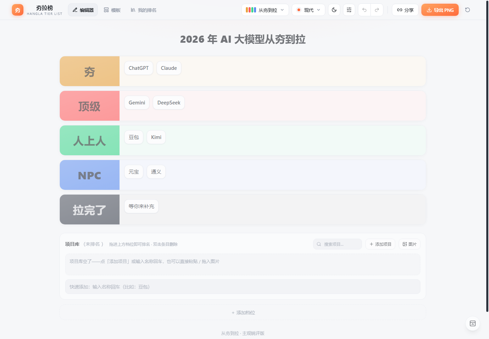

# Cloudflare 部署记录：hangla

> 记录时间：2026-11-14（Asia/Shanghai）
> 目的：用本仓库 `cloudflare-deploy` 技能把 GitHub 项目 `ChenChen913/hangla` 部署到 Cloudflare Pages，并记录实际体验、验证结果、缺陷和后续建议。**本文件不包含任何 Token/密钥值。**

## 1. 结论

| 项目 | 结果 |
|---|---|
| 部署目标 | Cloudflare Pages，项目名 `hangla` |
| 部署方式 | Direct Upload（本地 `wrangler pages deploy`） |
| 生产地址 | **https://hangla-9bk.pages.dev/** |
| 本次部署地址 | https://bd739464.hangla-9bk.pages.dev/ |
| 部署 ID | `bd739464-6cca-4f5e-9916-edf675ddfc5f` |
| 分支 / 源提交 | `main` / `7273816`（hangla 仓库） |
| GitHub Pages 备用 | 保留且仍可访问：https://chenchen913.github.io/hangla/（200） |
| 自动验收 | `verify-deployment.mjs`：**通过 9 / 警告 0 / 失败 0 / 跳过 3**，退出码 0 |
| 总体评价 | 部署成功；技能主流程可用，但仍有几处真实使用中暴露的体验/文档缺口（见第 5 节） |



## 2. 项目与构建

| 项 | 值 |
|---|---|
| 仓库 | https://github.com/ChenChen913/hangla |
| 本地目录 | `%USERPROFILE%\Desktop\hangla` |
| 源码提交 | `7273816`（克隆时最新 `main`） |
| 技术栈 | Vite 6 + React 19 + TypeScript 5.8 + Tailwind CSS 4 |
| 包管理器 | npm（`package-lock.json`） |
| Node / npm | v24.18.1 / 11.12.1 |
| 构建命令 | `npm ci` → `npm run build:web` |
| 输出目录 | `dist-web/` |
| 产物 | 9 个文件，约 1.74 MiB；最大字体 1.10 MiB |
| 路由 | React Router `HashRouter`（`#/templates`、`#/mine`、`#/r/:data` 等） |
| 现有托管 | GitHub Pages（`.github/workflows/deploy-pages.yml` 使用 `build:web` + `dist-web`） |

### 构建时遇到的环境问题

直接执行 `npm run build:web` 时 TypeScript 报：

```text
error TS2688: Cannot find type definition file for 'd3-interpolate'.
error TS2688: Cannot find type definition file for 'lodash'.
```

根因不是 hangla 仓库：`%USERPROFILE%\node_modules\@types\` 下存在与本项目无关、损坏/空的祖先类型目录，TypeScript 自动包含祖先 `@types` 时命中了它们。处理方式：

1. 临时创建 `tsconfig.deploy-temp.json`，只把 `typeRoots` 指到项目自己的 `./node_modules/@types`；
2. `npx tsc --noEmit -p tsconfig.deploy-temp.json` 通过；
3. `npx vite build --mode web` 生成 `dist-web/`；
4. 删除临时 tsconfig。

这项不是 `cloudflare-deploy` 的缺陷，但说明“`check-env` 的 `canBuild=true`”不等于项目构建命令一定能跑通；Windows 上全局/祖先 `node_modules` 污染值得写进 troubleshooting。

### 为静态验收补充的文件

`check-build --mode static` 初始给出高危警告：缺少顶层 `404.html`。为了让未知路径返回真正的 404，而不是依赖 Pages 的默认回退，新增了：

- `hangla/public/404.html`（本项目本地新增，未提交到 hangla 仓库；构建后会进入 `dist-web/404.html`）

该页无外部依赖，使用相对链接 `./` 返回首页，适用于根路径和 GitHub Pages 的子路径部署。

## 3. 执行流程与命令

> 真实 Token 只放在本机临时环境变量文件中，未写入仓库、未写入本记录；任务结束后删除。以下命令省略凭据。

```text
# 0. 链路探针（技能脚本）
node <cloudflare-deploy>/scripts/probe.mjs
# => ready：network / wrangler / auth / account-id / api-read 全部通过

# 1. 只读识别
node <cloudflare-deploy>/scripts/detect-project.mjs %USERPROFILE%\Desktop\hangla --human
# => vite (spa)，npm，node >=20；dist-web confirmed；GH Pages configured；suggestedMode=spa

# 2. 环境检查
node <cloudflare-deploy>/scripts/check-env.mjs --target pages --json
# => canBuild=true, canDeploy=true；wrangler 4.162.0；Cloudflare 登录态 pass

# 3. 构建
cd %USERPROFILE%\Desktop\hangla
npm ci
# 环境 typeRoots 问题处理见第 2 节
npx tsc --noEmit -p tsconfig.deploy-temp.json
npx vite build --mode web

# 4. 产物检查
node <cloudflare-deploy>/scripts/check-build.mjs --dir %USERPROFILE%\Desktop\hangla\dist-web --mode static --json
# => 9 files / 1.74 MiB；blocking=0, warnings=0

# 5. 创建 Pages 项目并部署（真实部署）
wrangler pages project create hangla --production-branch main
cd %USERPROFILE%\Desktop\hangla
wrangler pages deploy dist-web --project-name hangla --branch main --commit-dirty=true
# => https://bd739464.hangla-9bk.pages.dev

# 6. 验收
node <cloudflare-deploy>/scripts/verify-deployment.mjs \
  --url https://hangla-9bk.pages.dev --mode static --json
```

注意：第一次部署时命令从 `cloudflare-deploy` 目录执行，Pages 记录的 Source 是 cloudflare-deploy 的提交 `7ba301d`；后来在 hangla 目录重新部署，Source 修正为 hangla 的 `7273816`。**Wrangler 的 source commit 取当前工作目录，部署大仓/技能仓时应先 `cd` 到目标项目。**

## 4. 验收结果

### 4.1 自动验收（最终一次）

```text
[通过] root: GET / -> 200，12307ms
[通过] content-type: text/html; charset=utf-8
[通过] 404: GET __cf_deploy_check_…/ -> 404（static 模式）
[通过] title: 夯拉榜 · 从夯到拉排行榜生成器
[跳过] canonical: 没有 canonical 标签
[跳过] meta-robots: 没有 meta robots
[通过] assets: 2 个同源资源正常（共 2 个，覆盖首页引用）；其中 2 个 HEAD 不可用，改用 GET
[通过] server: cloudflare
[跳过] x-robots-tag: 无
[通过] cache-control: public, max-age=0, must-revalidate
[通过] security-headers: x-content-type-options、referrer-policy
[通过] index-redirect: GET /index.html -> 308 -> /（同源，收敛到站点根 /）

模式=static，通过=9 警告=0 失败=0 跳过=3
```

说明：`canonical` / `meta-robots` / `x-robots-tag` 被跳过，是因为 hangla 页面本身没有这些标签；不是验收通过，而是“未验证/不适用”。这对公开站点是一个需要决策的 SEO 项（见第 5、6 节）。

### 4.2 产物与资源

- `check-build`：9 个文件、约 1.74 MiB；文件数远低于 Free 20,000 上限；最大文件 1.10 MiB；首页引用 2 个同源资源均存在。
- 部署后逐个请求 `dist-web` 中文件：
  - `assets/*.js`、`assets/*.css`、`assets/*.woff2`：均 **200**；
  - `index.html`、`404.html`：直接请求返回 **308**（Pages 的 pretty URL 重定向），跟随到规范路径后正常；
  - 未知路径：自定义 404 页面，HTTP 状态 **404**。
- 生产首页响应头包含 `Server: cloudflare`、`x-content-type-options: nosniff`、`referrer-policy: strict-origin-when-cross-origin`、`Access-Control-Allow-Origin: *`、`Cache-Control: public, max-age=0, must-revalidate`。
- 历史部署预览别名 `https://bd739464.hangla-9bk.pages.dev/` 可访问（200）；首次创建后立即请求曾出现一次 TLS/连接异常，随后恢复，属网络瞬时问题。

### 4.3 浏览器冒烟测试

用本机 Chrome 157 headless 实际渲染：

- 首页 200，标题为 `夯拉榜 · 从夯到拉排行榜生成器`，`#root` 已渲染出编辑器、Tier 列表、项目库和导出按钮；
- 截图见 `assets/hangla-home.png`；
- Hash 路由：
  - `#/templates` → 页面出现“模板库”；
  - `#/mine` → 页面出现“我的排名”；
  - `#/preview` → 正常渲染预览页（无数据时回到可用占位状态）；
- 三个路由均未出现 `__err_box` 错误浮层；Chrome 日志中没有本应用 JS 异常（只有本机扩展缓存噪声）；
- 未知路径返回自定义 404 页（标题“页面未找到 · 夯拉榜”，有“返回首页”链接）。

### 4.4 备用站

GitHub Pages 仍为 **200**：https://chenchen913.github.io/hangla/ 。本次没有修改 GitHub Pages 配置、DNS 或 hangla 仓库的 GitHub workflow。

## 5. 对 cloudflare-deploy 的评价

### 好用的地方

1. **probe 的 fail-closed 设计很实用。** Token 以环境变量提供时，`wrangler whoami`/账号/`api-read` 一次探明；本次直接得到 `ready`，没有靠猜。
2. **detect-project 输出清晰。** 正确识别 Vite/SPA、npm、Node 版本、`dist-web`、GitHub Pages 配置和待确认风险（域名/DNS、Git 集成、后端需求）。
3. **check-env 退出码明确。** `canBuild=true / canDeploy=true` 与 wrangler/账号状态一致，后续脚本行为符合预期。
4. **check-build 的建议有行动价值。** 发现缺少 `404.html` 的高危警告；补上后 `blocking=0, warnings=0`，文件数/大小/资源检查都正确。
5. **verify-deployment 的证据粒度好。** 不只看首页：404 状态、标题、同源资源、`/index.html` 收敛、Cloudflare 响应头、canonical/meta 跳过项都分开报告，退出码能直接用。
6. **模板（plan/report）和文档结构清楚。** 适合把一次部署写成可复核的记录；本次记录也按它的字段组织。

### 不好用 / 缺什么

| # | 问题 | 影响 | 建议 |
|---|---|---|---|
| 1 | **`detect-project` 对 HashRouter SPA 建议 `spa` 模式**，但默认产物没有 `_redirects` 或 SPA fallback；直接按建议用 `--mode spa` 验收未知路径会得到 404，而不是 200 app shell | 模式选错会得到相反验收结论 | 识别 `HashRouter`/`BrowserRouter`（或提示人工确认），对 HashRouter 建议 `static` + `404.html`；文档补一张“HashRouter vs BrowserRouter 模式选择”表 |
| 2 | **构建脚本失败不一定被 check-env 发现**：`canBuild=true`，但 `npm run build:web` 因祖先 `node_modules/@types` 污染报 TS2688 | 新手会误以为项目坏/技能判断错 | troubleshooting 增加“TypeScript 自动包含祖先 @types”案例及 `typeRoots`/干净环境排查建议；或在 check-env 里提示检查构建命令 |
| 3 | **verify-deployment 对瞬时网络错误直接判 fail，没有重试**：本次连续两次 `UND_ERR_CONNECT_TIMEOUT`，第三次才 9/9 通过 | 真实部署成功却得到假失败，容易误判 | 增加 `--retry` / 瞬时连接失败重试一次，并在输出中区分“网络连接失败”和“HTTP 断言失败” |
| 4 | **自动验收只覆盖 HTTP/资源，不执行 JS。** 页面白屏也能得到 root 200 + 资源 200 | SPA/React 部署可能“HTTP 全绿但页面不可用” | 可选增加 browser smoke（打开首页、等待 `#root` 非空、收集 console error）；默认套件可保持零依赖 |
| 5 | **canonical/meta 缺失时只是 skip，不会提醒 SEO 风险。** 本次 Cloudflare 与 GitHub Pages 内容相同，但两者都没有 canonical/noindex | 公开重复内容可能影响索引 | 在部署报告模板里把“是否有 canonical / 是否保留 GH Pages”列为必须决策；或检查到两者并存时给 warn |
| 6 | **Wrangler source commit 取当前工作目录。** 第一次从技能仓执行部署，Pages 记录的是 cloudflare-deploy 的提交 | 部署来源可追溯性错误 | 文档明确写“部署前 `cd` 目标项目”，或部署脚本校验 cwd 与目录一致 |
| 7 | **`check-build` 关于“缺少 404 时 Pages 回退到 / 200”的说法本次未实际复现。** 我们直接补了 404，没有保留一个无 404 的对照部署 | 无法确认该提示的精确性 | 若要保留该提示，补一个真实 Pages 对照实验或改写为“不同 Pages 配置/行为可能不同，建议显式提供 404.html” |
| 8 | **Pages 项目名与实际域名后缀不一致。** 项目名 `hangla`，实际默认域名是 `hangla-9bk.pages.dev`（创建时分配的别名） | 用户会按项目名猜 URL 而访问失败 | 部署输出/文档提示“以 wrangler 输出的 *.pages.dev 为准”；记录项目名与域名两个值 |

### 还需要补的

- 自定义域名 / DNS（本次只用了 `pages.dev` 默认域名）。
- Pages Git 集成或 CI 部署（本次 Direct Upload；后续更新需要手动重新构建上传）。
- canonical / noindex / GitHub Pages 去留策略。
- 浏览器级交互测试：拖拽、分享链接、PNG 导出（本次只验证渲染和路由，没有自动化拖拽/下载）。
- 性能/冷启动、移动端、并发；单次 TTFB 不构成结论。
- R2 未使用（项目没有 R2 需求）；GitHub Token 未用于克隆（仓库公开）。

## 6. 未验证事项

| 项目 | 原因 |
|---|---|
| 自定义域名、DNS、SSL 证书 | 用户未提供域名，也没有要求改 DNS |
| 分享/导出 PNG 的真实交互 | 需要浏览器自动化点击、下载和人工核对，本次未展开 |
| 拖拽排序、localStorage 持久化、移动端布局 | 只做了首屏/路由渲染冒烟，未做完整交互回归 |
| 性能/冷启动/并发 | 单次 HTTP 采样，不是性能结论 |
| 搜索收录/SEO 效果 | canonical、meta robots 缺失，且 GitHub Pages 与 Pages 同时公开 |
| Cloudflare 套餐/配额/计费 | 只有默认 Free 事实；未在控制台核对套餐设置 |
| GitHub Pages 历史/回滚 | 只验证备用站仍为 200，未执行 GitHub Pages 配置变更 |

## 7. 回滚

| 方式 | 范围 | 备注 |
|---|---|---|
| Cloudflare Dashboard 回滚到前一部署 | 仅 Cloudflare Pages | 前一部署 `d4a73ed9-…`（内容与本次相同，仅 source 字段不同） |
| 删除 Pages 项目 `hangla` | 仅 Cloudflare，彻底移除默认域名 | `wrangler pages project delete hangla`；不可逆，需确认 |
| GitHub Pages | 未改动 | 继续作为备用站；如需完全回退，停止使用 Cloudflare 域名即可 |
| hangla 源码 | 未提交改动 | 本地仅新增未跟踪的 `public/404.html`；删除该文件即可恢复原构建行为 |

## 8. 安全与清理备注

- 本次使用的 Cloudflare API Token、Account ID、R2 密钥和 GitHub Token 均未写入仓库或此记录；Cloudflare 凭据通过本机临时环境变量文件使用，任务结束时已删除。但它们曾在会话中明文提供，**建议任务结束后全部轮换/吊销**，尤其是 R2 Access Key 和 GitHub PAT（本次未使用 R2 和 GitHub PAT）。
- 临时凭据环境文件：`%TEMP%\hangla-deploy\cf-env.ps1`，任务结束后删除。
- 临时 wrangler 工具目录：`%TEMP%\hangla-tools\`，可按需删除。
- 部署产物与本地 clone：`%USERPROFILE%\Desktop\hangla`，未修改上游仓库历史。

### 凭据处置状态（记录编写时）

无法从当前执行环境确认以下凭据是否已经在 Cloudflare/GitHub 控制台轮换或吊销，因此**全部标为“待确认”，不声称已完成**。表中不包含任何 Token、密钥或账号值。

| 凭据类型 | 是否写入仓库/记录 | 轮换/吊销状态 |
|---|---|---|
| Cloudflare API Token | 否 | **待确认**——会话中曾明文提供；请到 Cloudflare 控制台确认/轮换 |
| Cloudflare Account ID | 否 | **待确认**——不是密钥，但曾明文提供；是否需要在账号侧处理由用户判断 |
| R2 Access Key / Secret | 否 | **待确认**——本次未使用 R2；建议吊销旧 Key |
| GitHub PAT | 否 | **待确认**——本次未用 Token 克隆（仓库公开）；建议吊销旧 PAT |

## 9. 由本记录驱动的 cloudflare-deploy 完善（已完成）

以下改动已写入技能仓库，并有对应测试：

| 记录中的问题 | 已做的改动 |
|---|---|
| HashRouter 被建议成 `spa`（模式选反） | `detect-project.mjs` 新增 `spaRouting`（hash/history/unknown/mixed），HashRouter 建议 `static` + 404.html；history 路由建议 `spa` + 显式 fallback。新增 HashRouter / BrowserRouter 合成项目和测试 |
| `verify-deployment` 瞬时网络错误直接判 fail | 新增 `scripts/net-retry.mjs`；默认对连接类瞬时错误重试 1 次，`--retries 0..3` 可调；HTTP 4xx/5xx、证书/DNS 解析错误、脚本自身单次超时不重试；JSON 带 `retry`，失败项带 `attempts`/`errorKind`，detail 区分网络失败与 HTTP 断言失败 |
| canonical/meta 缺失只 skip，不提醒 SEO | canonical/meta robots/X-Robots-Tag 全缺失时新增 `seo` warn（不改退出码）；报告模板要求双站并存时明确 self-canonical / noindex |
| Pages 缺 404 的回退说法未核实 | 已补 Cloudflare 官方 [Serving Pages](https://developers.cloudflare.com/pages/configuration/serving-pages/#single-page-application-spa-rendering) 依据：官方写“按 SPA 处理、未知路径返回 `/`”，未写状态码，实际通常 200；并注明该回退也影响缺失静态资源，不能只看状态码 |
| Wrangler Source commit 取 cwd | 文档/技能部署规则明确：Direct Upload 前先 `cd` 目标项目根目录，建议显式 `--commit-hash`；报告模板增加“部署目录 / Source commit”字段 |
| Pages 项目名 ≠ 实际域名 | 文档改为以 wrangler 输出的 `*.pages.dev` 为准（项目名被占用时可能带随机后缀），报告模板增加“项目名 / 默认域名”字段 |
| `canBuild=true` 但项目 build 失败（TS 祖先 @types） | troubleshooting 增加 TS2688 案例与临时 `typeRoots` 修法；技能文档明确 `canBuild` 不执行 project build |
| 自动验收没有浏览器级检查 | 报告模板新增“浏览器冒烟”行；verification 文档要求 SPA 记录真实浏览器检查，HTTP 全绿不能当页面可用 |

测试：`node tests/run-tests.mjs` → **739/739**（unit 120、core 295、adversarial 276、boundary 43、combination 5）；`node tests/check-skill.mjs` 通过。
